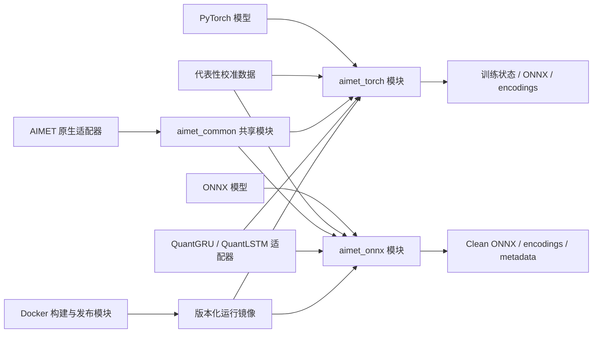
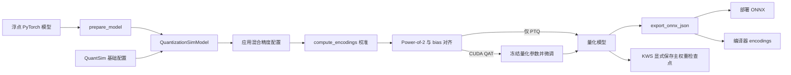
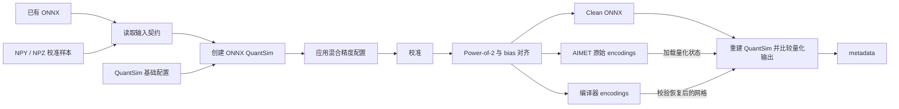
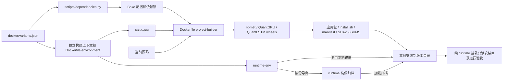

# rx-met 系统架构

本文档描述 rx-met 当前的系统结构、模块接口、量化数据流和发布架构。用户操作见
[用户使用指南](./User_guide.md)，配置字段见[量化配置](./Quant_config.md)，关键设计
理由见 [`adr/`](./adr/)。

## 1. 目标与范围

rx-met 面向 Linux x86_64 CPU 和 NVIDIA GPU 上的小模型量化，目标包括：

- 为 PyTorch 模型提供 PTQ、QAT、混合精度、Power-of-2 和 ONNX 导出流程。
- 为已有 ONNX 模型提供直接 PTQ 和编译器制品导出流程。
- 通过 QuantGRU / QuantLSTM 提供可校准、可训练的量化循环算子。
- 复用共享量化算法和配置，保持 PyTorch、ONNX 与部署制品的一致性。
- 通过版本化 Docker 镜像提供可复现的构建和运行环境。

发布变体包括 `cpu`、`cu118`、`cu126` 和 `cu130`。CPU 支持校准与 PTQ，浮点训练和
QAT 使用 CUDA。大模型量化由其他项目负责。

## 2. 系统上下文

PyTorch 和 ONNX 是两条独立量化入口。`aimet_common` 提供共享算法，`native` 提供
C++/CUDA 实现，QuantGRU / QuantLSTM 在 PyTorch 中替换原始循环层；ONNX PTQ
也通过原生循环层适配器复用这些算子的校准与量化前向。

## 3. 模块划分

| 模块 | 主要接口 | 职责 |
| --- | --- | --- |
| `aimet_common` | QuantSim 公共定义、配置规则、Power-of-2 数值函数 | 框架无关的量化算法、图规则和原生库加载 |
| `aimet_torch` | `QuantizationSimModel`、混合精度工具、QAT 工具、`export_onnx_json()` | PyTorch 图准备、量化器管理、QuantGRU / QuantLSTM 协作和导出后处理 |
| `aimet_onnx` | ONNX QuantSim、`run_onnx_ptq()`、`CompilerEncodingConverter` | ONNX Runtime 会话、校准、Po2 对齐和节点级 encoding 映射 |
| `native` | 安装到 `aimet_common` 的 Python 扩展和 ONNX Runtime custom op | AIMET C++/CUDA 量化内核与 Python binding |
| `quant_gru` / `quant_lstm` | `QuantGRU` / `QuantLSTM`、`GRU_config` / `LSTM_config`、量化参数导入导出 | CPU/CUDA 循环层、校准器、LUT、定点推理和 CUDA 反向传播 |
| 构建与发布 | `scripts/environment/*.sh`、`scripts/release/*.sh` | 依赖锁、环境镜像、项目 wheel、验收和归档 |

`aimet_onnx.rx_ptq` 根据 ONNX、配置和校准数据创建 QuantSim，完成校准、Power-of-2、bias 对齐、
制品导出和恢复验证。发布入口根据所选 CPU/CUDA 变体查找环境、构建 wheel、组装应用包并执行离线安装自检。

## 4. PyTorch 量化流程

标准入口位于 [`examples/quick_start_kws.py`](../examples/quick_start_kws.py)。

流程接口遵循以下约束：

1. `prepare_model` 在 QuantSim 创建前完成模型图规范化。
2. 基础配置在创建 QuantSim 时加载，混合精度配置在校准前应用。
3. `compute_encodings` 使用代表性数据收集激活范围，参数编码从模型权重和偏置计算。
4. Power-of-2 对齐修改实际量化器 scale；普通层的 bias 可对齐到 `Sb = Sx * Sw`。
5. KWS 的 QAT 阶段冻结量化参数和 BatchNorm 状态；只做 PTQ 时直接导出。
6. KWS 在导出前将 QuantSim 模型切换到 CPU 和 eval 模式，导出器以 CPU 上的浮点模型生成 ONNX 图。
7. 重载流程使用相同的模型准备参数、配置文件、默认位宽和量化方案。

KWS 的 `--ptq-only` 路径从浮点检查点开始，跳过训练和 QAT，支持 CPU/CUDA。
KWS 在导出接口之外显式保存主权重；`export_onnx_json()` 只返回 ONNX 和编码路径。
主权重检查点不包含 QuantSim 内部状态；重载时先加载主权重，再创建 QuantSim 并加载
编译器 encodings。

QuantGRU / QuantLSTM 与其他模块共享同一次 `compute_encodings` 前向过程。循环层通过自己的
校准实现收集内部算子范围，并通过 `GRU_config` / `LSTM_config` 接收位宽和量化粒度。

## 5. ONNX PTQ 流程

标准入口位于 [`examples/quick_start_onnx_ptq.py`](../examples/quick_start_onnx_ptq.py)，
主要实现位于 [`src/aimet_onnx/rx_ptq`](../src/aimet_onnx/rx_ptq/)。

`run_onnx_ptq()` 提供端到端接口。`CompilerEncodingConverter` 把已启用量化器映射到
节点输入、节点输出或参数条目，并输出 `schema_version: 4`，统一使用
`real = scale * (q - zero_point)`。导出过程检查覆盖率和
孤立键。Clean ONNX 与编译器 encodings 作为同一组部署制品使用。
恢复验证从 Clean ONNX 重建 QuantSim，加载同次导出的 `.aimet.encodings`，再将
恢复后的编译器编码与磁盘 `.json` 对照，并比较导出前后的量化输出。编译器 JSON
用于部署和网格校验，不作为 ONNX QuantSim 的编码加载文件。

独立 ONNX 适配器的设计理由见
[ADR 0001](./adr/0001-direct-onnx-ptq-compiler-adapter.md)，encoding 与 Po2 决策见
[ADR 0002](./adr/0002-compiler-native-encodings-and-po2.md)。

## 6. QuantGRU / QuantLSTM 集成

QuantGRU 位于 [`operators/quant-gru`](../operators/quant-gru/)，通过
`quant_gru.QuantGRU` 提供 PyTorch 模块接口；QuantLSTM 位于
[`operators/quant-lstm`](../operators/quant-lstm/)，接口为 `quant_lstm.QuantLSTM`。两者支持：

- `num_layers=1`。
- `dropout=0`。
- 单向和双向循环层。
- CPU/CUDA 浮点、校准和 PTQ 前向，以及 CUDA 训练与 QAT。CPU 原生前向使用 `eval()`。
- MinMax、SQNR 和 Percentile 校准。
- per-tensor、per-gate 和 per-channel 权重、偏置量化。

`apply_mixed_precision_bitwidth()` 识别循环层实例，并把混合精度 JSON 中的
`GRU_config` / `LSTM_config` 交给对应算子。Python 接口调用原生扩展，扩展再
调用 CPU/CUDA 实现。量化参数导出与整模型导出通过 `src/aimet_torch/rx_export`
汇合。

整模型调用顺序与接入点对照见[循环算子接入](QuantLSTM_integration.md)，h/c 状态和参数回读的
完整协议见[算子编码参考](../operators/quant-lstm/docs/aimet_integration.md#编码与-onnx)。

## 7. AIMET 原生适配器

[`native`](../native/) 保存 `aimet_common` 和 `aimet_onnx` 所需的 C++/CUDA 实现：

| 路径 | 职责 |
| --- | --- |
| `native/common` | 通用量化核心和 `_libpymo` binding |
| `native/onnx` | `libquant_info` 和 ONNX Runtime custom op |
| `docker/environment/third_party/onnxruntime` | 固定版本的 ONNX Runtime 头文件与许可证 |
| `native/tests` | CPU/CUDA Execution Provider 冒烟测试 |

原生构建向 `src/aimet_common` 安装 `_libpymo`、`libquant_info` 和
`libaimet_onnxrt_ops.so`。Python wheel 构建会检查这些文件的完整性。源码来源、ABI
和构建命令见 [AIMET ONNX 原生运行库](./AIMET_ONNX_NATIVE.md)。

## 8. 配置接口

| 配置 | 权威来源 | 消费模块 |
| --- | --- | --- |
| Python 兼容范围与包依赖 | `pyproject.toml` | Python 构建模块 |
| CPU/CUDA 变体与精确依赖 | `docker/variants.json` | 依赖工具和 Docker 构建模块 |
| QuantSim 基础配置 | `examples/config/mrnn_quantsim_config_custom_mixed_precision_v2.json` | PyTorch 与 ONNX QuantSim |
| 混合精度与循环层配置 | `examples/config/quick_start_full_quant.json` | PyTorch 与 ONNX 混合精度适配器、QuantGRU / QuantLSTM |

`scripts/dependencies.py lock` 根据 `docker/variants.json` 生成
`docker/docker-bake.hcl` 和 `docker/requirements/*.lock`。生成文件由一致性测试校验。

配置匹配优先级是精确模块名、模块类型、通配符、默认配置。已注册但当前模型缺少的
量化模块类型会被跳过，未知类型会触发配置错误。

## 9. 构建与发布架构

环境镜像和应用包使用独立版本；公共环境名和版本由 `docker/variants.json` 定义，
环境定义由本仓库维护，并通过环境版本标签复用兼容镜像：

- 环境版本随 CUDA、Python、Torch、ONNX Runtime 或构建工具链变化。
- 项目版本随 AIMET Python、原生实现、QuantGRU / QuantLSTM、示例或产品行为变化。
- 项目构建复用匹配的 build-env 和 runtime-env。

`scripts/release/build.sh` 是发布构建入口，`scripts/release/verify_bundle.sh` 是安装包验收
入口。产品目录包含应用归档及各自的 `.sha256`；独立环境目录包含镜像归档、每镜像的
`.sha256` / `.json` 和 README。示例源码及应用文件校验清单位于应用包内。
完整操作说明见 [Docker 构建与发布](./Release_packaging.md)。

## 10. 制品关系

| 制品 | 生产模块 | 主要用途 |
| --- | --- | --- |
| rx-met wheel | 项目 builder | 安装 `aimet_common`、`aimet_torch` 和 `aimet_onnx` |
| QuantGRU wheel | QuantGRU builder | 安装 `quant_gru` 和对应 CPU/CUDA 原生扩展 |
| build-env / runtime-env | 环境构建模块 | 固化编译环境与运行依赖 |
| 应用包 | 发布构建模块 | `install.sh` 在匹配的 runtime 中安装项目包；README 说明 Docker 运行方式 |
| runtime 镜像归档 | 环境导出入口或发布命令的 `--with-env` | 将匹配的 runtime 交付给没有本地镜像的机器 |
| QuantLSTM wheel | QuantLSTM builder | 安装 `quant_lstm`、对应 CPU/CUDA 原生扩展和默认配置 |
| PyTorch 检查点 | KWS 示例 | 主权重、网络类型和外置 MFCC 状态；量化编码单独保存 |
| 部署 ONNX + encodings | PyTorch 导出流程 | PyTorch 模型部署 |
| Clean ONNX + compiler encodings | ONNX PTQ 流程 | 已有 ONNX 模型部署 |
| metadata | ONNX PTQ 流程 | 输入、校准、Po2、覆盖率和数值对比记录 |

模型文件和 encodings 按同一次导出结果配套使用。应用包内的 `manifest.json` 描述安装内容，
归档同名 `.sha256` 校验分发文件；应用包内的 `SHA256SUMS` 校验应用文件。

## 11. 验证策略

| 验证层级 | 入口 | 覆盖内容 |
| --- | --- | --- |
| 依赖配置 | `tests/release/test_dependencies.py` | 版本范围、变体矩阵、Bake 配置和 lock 一致性 |
| AIMET 原生库 | `native/tests/smoke_onnx_runtime.py` | Python 扩展和 ONNX Runtime custom op |
| QuantGRU | `operators/quant-gru/tests/` | 浮点、量化、校准、训练和导出行为 |
| QuantLSTM | `operators/quant-lstm/tests/` | 浮点、量化、校准、CUDA 训练和导出行为 |
| 应用安装目录 | `scripts/release/verify_bundle.sh` | 包版本、原生依赖、AIMET、QuantGRU / QuantLSTM；CPU PTQ 或显式启用的 GPU 冒烟流程 |
| KWS 示例 | `scripts/release/verify_kws_example.sh` | PyTorch PTQ、Po2、QAT、导出和重载 |
| ONNX PTQ 示例 | `scripts/release/verify_onnx_ptq_example.sh` | ONNX 校准、Po2、制品导出和重载 |
| CPU/GPU 示例对照 | `scripts/validation/verify_examples_cpu_gpu.py` | 同一检查点、固定样本下的 Torch/ONNX PTQ 制品和逐阶段输出比较 |

正式发布应完成静态验收和对应设备的示例验证；CUDA 变体还需目标 GPU 验收。

## 12. 约束与风险

- 原生 AIMET 基线固定在 2.17.0。升级需要同时验证 Python 行为、原生 ABI、构建和
  encoding 格式。
- PyTorch 和 ONNX 流程共享配置与 Power-of-2 算法。共享实现集中在
  `aimet_common`，保持两条路径的行为一致。
- 编译器 encoding schema 是部署接口。schema 变化需要版本说明、兼容性策略和回归
  测试。
- 量化结果依赖模型、校准数据和配置。性能与精度结论需要记录完整复现条件。
- CUDA 变体声明需要在目标 GPU 和驱动环境验证，最低驱动兼容性需要在对应版本验收。
- runtime 与应用包的版本关系记录在 manifest 中，发布和回滚通过选择应用安装目录及
  其匹配的 runtime、启动新容器完成。

## 13. 架构决策

- [ADR 0001：使用独立的 ONNX PTQ 编译器适配器](./adr/0001-direct-onnx-ptq-compiler-adapter.md)
- [ADR 0002：输出使用真实 Power-of-2 scale 的编译器 encodings](./adr/0002-compiler-native-encodings-and-po2.md)
- [独立 runtime 与应用 bundle](./adr/0003-runtime-and-application-bundles.md)
- [统一编译器编码处理与导出入口名称](./adr/0003-shared-compiler-encodings.md)
- [GRU carrier 共用整数目标前向](./adr/0005-gru-shared-integer-forward.md)
- [FX 展开模块的参数量化归属](./adr/0006-fx-parameter-quantization.md)

新增模块或改变公开接口时，应同步更新本文档。非显然的设计取舍通过新 ADR 记录。
